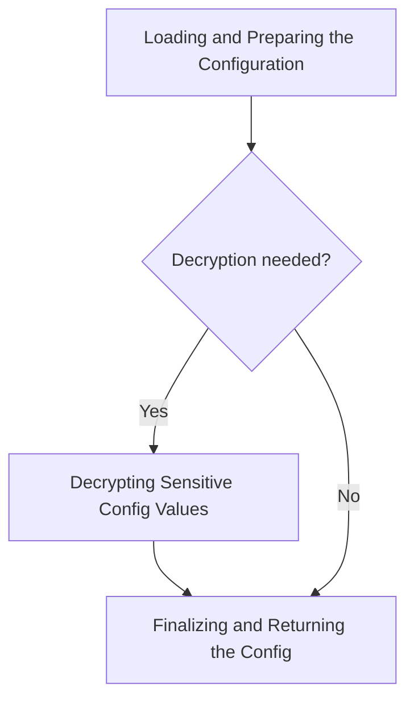
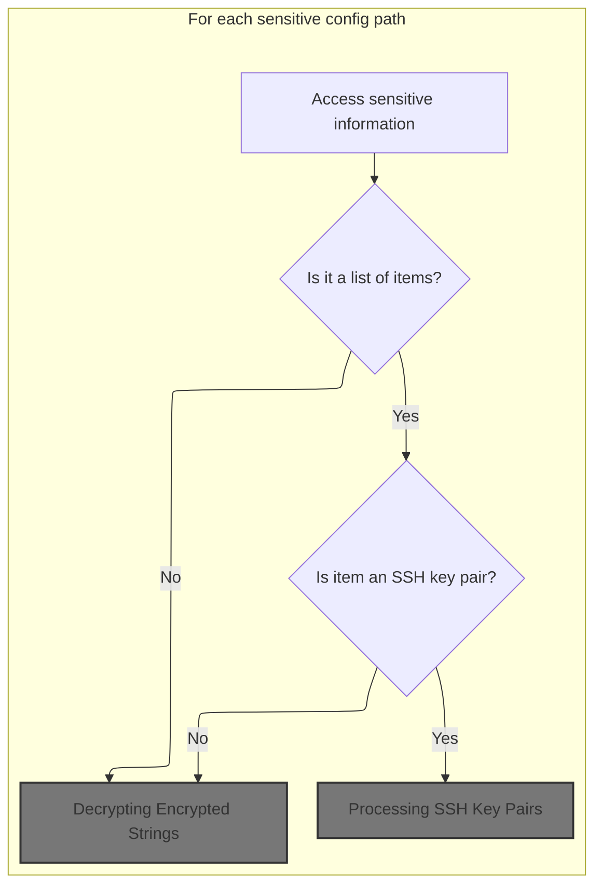
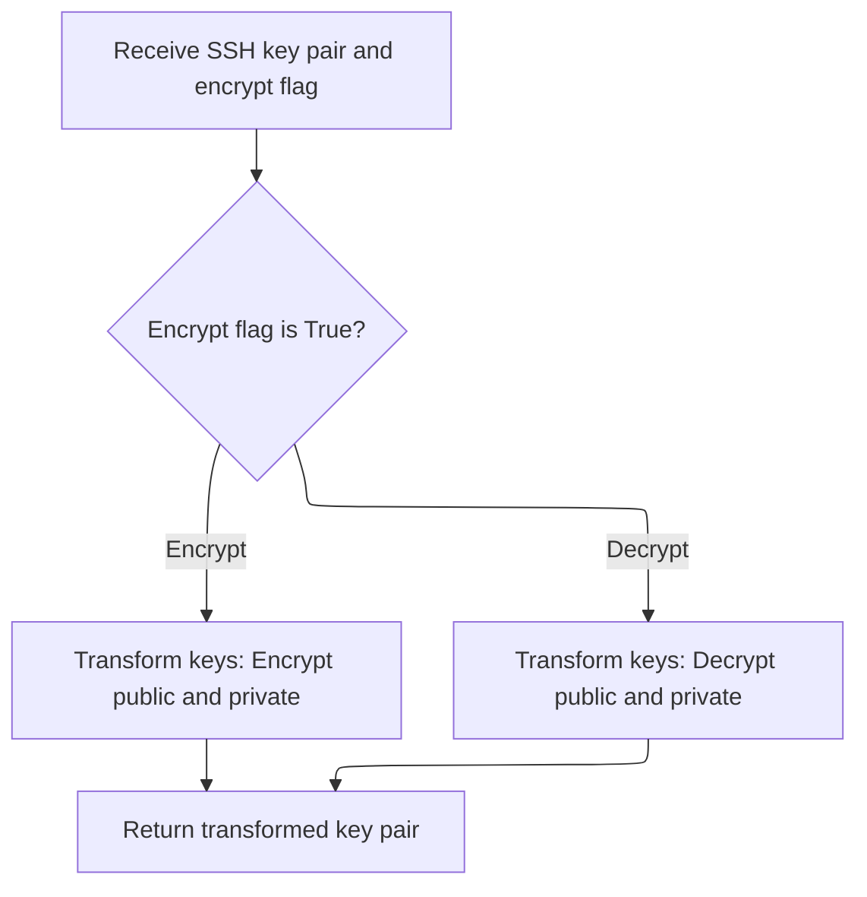
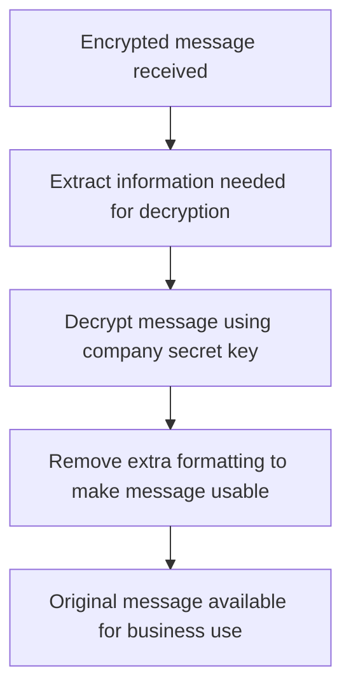

This document describes how configuration data is prepared and delivered to other system components. The process ensures that only the necessary and usable configuration values are returned, with sensitive fields decrypted as needed. The flow receives a request specifying which configuration version to use and whether to decrypt sensitive values, and returns a finalized configuration object ready for use.



# Loading and Preparing the Configuration

This section ensures that the configuration used by the system is accurate, free of unnecessary metadata, and contains usable values by decrypting any encrypted fields as needed.

| Category        | Rule Name                | Description                                                                                                                                                                               |
| --------------- | ------------------------ | ----------------------------------------------------------------------------------------------------------------------------------------------------------------------------------------- |
| Data validation | Metadata removal         | All metadata fields, specifically 'name' and '\_id', must be removed from the configuration before it is used by other system components.                                                 |
| Business logic  | Config version selection | The configuration must be loaded from the database using the appropriate key: 'initial' for the initial configuration or 'newconfig' for the current configuration, based on the request. |
| Business logic  | Conditional decryption   | If decryption is requested and the configuration is not empty, all encrypted configuration values must be decrypted before the configuration is returned.                                 |

<SwmSnippet path="/monkey/monkey_island/cc/services/config.py" line="36">

---

In `get_config`, we fetch the config from the database and clean out metadata fields before doing anything else.

```python
    def get_config(is_initial_config=False, should_decrypt=True, is_island=False):
        """
        Gets the entire global config.
        :param is_initial_config: If True, the initial config will be returned instead of the current config.
        :param should_decrypt: If True, all config values which are set as encrypted will be decrypted.
        :param is_island: If True, will include island specific configuration parameters.
        :return: The entire global config.
        """
        config = mongo.db.config.find_one({'name': 'initial' if is_initial_config else 'newconfig'}) or {}
        for field in ('name', '_id'):
            config.pop(field, None)
```

---

</SwmSnippet>

<SwmSnippet path="/monkey/monkey_island/cc/services/config.py" line="46">

---

After cleaning up the config, we check if decryption is needed. If so, we call `decrypt_config` to turn any encrypted values into plaintext, making the config usable for the rest of the flow.

```python
            config.pop(field, None)
        if should_decrypt and len(config) > 0:
            ConfigService.decrypt_config(config)
```

---

</SwmSnippet>

## Decrypting Sensitive Config Values

This section describes the business rules governing the decryption of sensitive configuration values within the Infection Monkey backend. The purpose is to ensure that any sensitive fields in the configuration are securely decrypted before use, maintaining data confidentiality and integrity.

<SwmSnippet path="/monkey/monkey_island/cc/services/config.py" line="271">

---

`decrypt_config` just hands off the config and a flag to `_encrypt_or_decrypt_config`, which does the actual work of finding and decrypting the relevant fields. This keeps the logic for encryption and decryption in one place.

```python
    def decrypt_config(config):
        ConfigService._encrypt_or_decrypt_config(config, True)
```

---

</SwmSnippet>

## Traversing and Processing Encrypted Config Fields



This section governs how sensitive configuration fields are identified and processed for encryption or decryption. It ensures that all nested sensitive values, including SSH key pairs and encrypted strings, are correctly handled according to their type and the operation required.

<SwmSnippet path="/monkey/monkey_island/cc/services/config.py" line="297">

---

In `_encrypt_or_decrypt_config`, we loop through predefined key paths to find which nested config fields need to be processed. For each path, we walk down the config dict to the target value, prepping it for encryption or decryption depending on the flag.

```python
    def _encrypt_or_decrypt_config(config, is_decrypt=False):
        for config_arr_as_array in ENCRYPTED_CONFIG_ARRAYS:
            config_arr = config
            parent_config_arr = None

            # Because the config isn't flat, this for-loop gets the actual config value out of the config
            for config_key_part in config_arr_as_array:
                parent_config_arr = config_arr
                config_arr = config_arr[config_key_part]
```

---

</SwmSnippet>

<SwmSnippet path="/monkey/monkey_island/cc/services/config.py" line="305">

---

Once we hit a sequence in the config, we check each element. If it's an SSH key pair (dict with 'public_key'), we call `decrypt_ssh_key_pair` to handle both keys at once. Other elements get processed normally.

```python
                config_arr = config_arr[config_key_part]

            if isinstance(config_arr, collections.Sequence) and not isinstance(config_arr, str):
                for i in range(len(config_arr)):
                    # Check if array of shh key pairs and then decrypt
                    if isinstance(config_arr[i], dict) and 'public_key' in config_arr[i]:
                        config_arr[i] = ConfigService.decrypt_ssh_key_pair(config_arr[i]) if is_decrypt else \
                            ConfigService.decrypt_ssh_key_pair(config_arr[i], True)
                    else:
```

---

</SwmSnippet>

### Processing SSH Key Pairs



This section manages the secure transformation of SSH key pairs by either encrypting or decrypting both the public and private keys based on a provided flag. It ensures that key pairs are handled securely according to the required operation.

<SwmSnippet path="/monkey/monkey_island/cc/services/config.py" line="320">

---

`decrypt_ssh_key_pair` either decrypts or encrypts both keys in the pair, depending on the flag. It calls into the encryptor to do the actual crypto work for each key.

```python
    def decrypt_ssh_key_pair(pair, encrypt=False):
        if encrypt:
            pair['public_key'] = encryptor.enc(pair['public_key'])
            pair['private_key'] = encryptor.enc(pair['private_key'])
        else:
            pair['public_key'] = encryptor.dec(pair['public_key'])
            pair['private_key'] = encryptor.dec(pair['private_key'])
        return pair
```

---

</SwmSnippet>

### Decrypting Encrypted Strings



This section governs how encrypted messages are securely decrypted and made available for business processes. It ensures that only properly formatted and encrypted messages are accepted, and that the decrypted output is accurate and usable.

<SwmSnippet path="/monkey/monkey_island/cc/encryptor.py" line="47">

---

`dec` takes a base64-encoded string, decodes it, pulls out the IV, decrypts the ciphertext with AES-CBC, and then strips off the padding before returning the plaintext.

```python
    def dec(self, enc_message):
        enc_message = base64.b64decode(enc_message)
        cipher_iv = enc_message[0:AES.block_size]
        cipher = AES.new(self._cipher_key, AES.MODE_CBC, cipher_iv)
        return self._unpad(cipher.decrypt(enc_message[AES.block_size:]).decode())
```

---

</SwmSnippet>

<SwmSnippet path="/monkey/monkey_island/cc/encryptor.py" line="39">

---

`_unpad` just chops off the number of characters from the end of the string as specified by the last character's ASCII value. This matches how PKCS#7 padding works.

```python
    def _unpad(self, message: str):
        return message[0:-ord(message[len(message) - 1])]
```

---

</SwmSnippet>

### Finishing Config Field Processing

<SwmSnippet path="/monkey/monkey_island/cc/services/config.py" line="314">

---

Back in `_encrypt_or_decrypt_config`, after handling SSH key pairs, we process any remaining elements in the sequence with the encryptor. If it's not a sequence, we just process the single value directly. This wraps up the per-field encryption/decryption logic.

```python
                        config_arr[i] = encryptor.dec(config_arr[i]) if is_decrypt else encryptor.enc(config_arr[i])
            else:
                parent_config_arr[config_arr_as_array[-1]] = \
                    encryptor.dec(config_arr) if is_decrypt else encryptor.enc(config_arr)
```

---

</SwmSnippet>

## Finalizing and Returning the Config

<SwmSnippet path="/monkey/monkey_island/cc/services/config.py" line="49">

---

After decrypting, `get_config` checks if we're not in island mode and removes 'aws_config' from the 'cnc' section. This keeps the returned config clean and context-appropriate.

```python
        if not is_island:
            config.get('cnc', {}).pop('aws_config', None)
        return config
```

---

</SwmSnippet>

&nbsp;

*This is an auto-generated document by Swimm 🌊 and has not yet been verified by a human*

<SwmMeta version="3.0.0" repo-id="Z2l0aHViJTNBJTNBYmFja2VuZC1zd2ltbSUzQSUzQXJpY2FyZG9sb3Blemc=" repo-name="backend-swimm"><sup>Powered by [Swimm](https://app.swimm.io/)</sup></SwmMeta>
