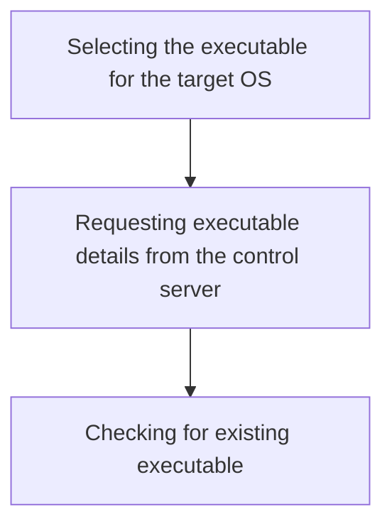
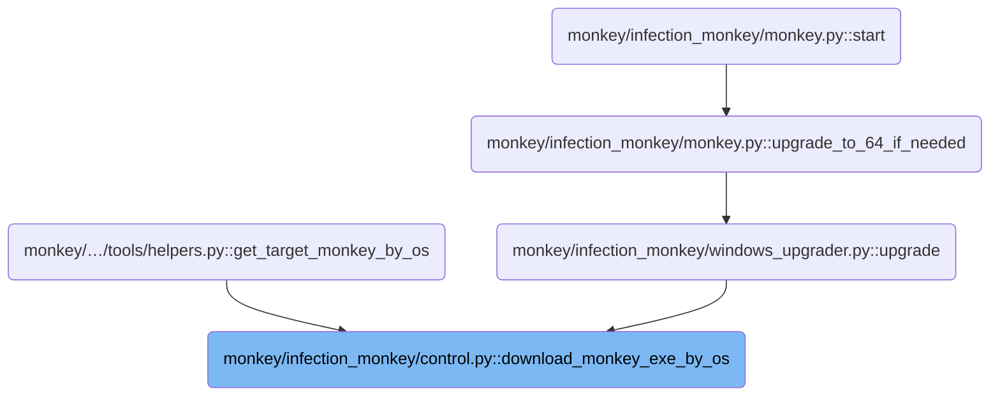
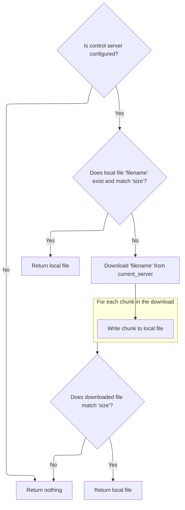

This document describes how the Infection Monkey system selects and retrieves the correct executable file for a target host, based on its operating system and architecture. The flow receives host OS and architecture information as input and returns a valid Infection Monkey executable file for deployment. The agent ensures it always runs the appropriate version by requesting executable details from the control server, validating the response, and either downloading the file or using an existing local copy.



# Where is this flow used?

This flow is used multiple times in the codebase as represented in the following diagram:



# Selecting the executable for the target OS

This section governs how the Infection Monkey system selects the correct executable file for the target operating system and architecture, ensuring that the infection tool runs properly on the intended host. The process involves spoofing host OS information and retrieving the appropriate executable filename and size from the control server.

<SwmSnippet path="/monkey/infection_monkey/control.py" line="215">

---

In <SwmToken path="monkey/infection_monkey/control.py" pos="215:3:3" line-data="    def download_monkey_exe_by_os(is_windows, is_32bit):">`download_monkey_exe_by_os`</SwmToken>, we kick off by spoofing the OS and architecture info and sending it to the control server to get the right executable filename and size. We need to call <SwmToken path="monkey/infection_monkey/control.py" pos="216:10:10" line-data="        filename, size = ControlClient.get_monkey_exe_filename_and_size_by_host_dict(">`get_monkey_exe_filename_and_size_by_host_dict`</SwmToken> next because it fetches the actual file details based on the target environment, not just a static value.

```python
    def download_monkey_exe_by_os(is_windows, is_32bit):
        filename, size = ControlClient.get_monkey_exe_filename_and_size_by_host_dict(
            ControlClient.spoof_host_os_info(is_windows, is_32bit))
        if filename is None:
            return None
```

---

</SwmSnippet>

## Requesting executable details from the control server

This section governs how the Infection Monkey client requests the correct executable details from the control server, based on the host's operating system and architecture. The goal is to ensure that the client receives the appropriate executable file name and its size for deployment on the target host.

<SwmSnippet path="/monkey/infection_monkey/control.py" line="277">

---

In <SwmToken path="monkey/infection_monkey/control.py" pos="277:3:3" line-data="    def get_monkey_exe_filename_and_size_by_host_dict(host_dict):">`get_monkey_exe_filename_and_size_by_host_dict`</SwmToken>, we send a POST request to the control server with the host's OS and architecture info. The next step is handled by the server-side logic in <SwmPath>[monkey/infection_monkey/monkey.py](monkey/infection_monkey/monkey.py)</SwmPath>, which figures out the right executable and returns its details.

```python
    def get_monkey_exe_filename_and_size_by_host_dict(host_dict):
        if not WormConfiguration.current_server:
            return None, None
        try:
            reply = requests.post("https://%s/api/monkey/download" % (WormConfiguration.current_server,),  # noqa: DUO123
                                  data=json.dumps(host_dict),
                                  headers={'content-type': 'application/json'},
                                  verify=False, proxies=ControlClient.proxies)
```

---

</SwmSnippet>

### Sending the executable request to the server

This section governs the process of sending executable requests from the client to the server, ensuring that requests are valid, authorized, and properly formatted before transmission.

| Category        | Rule Name                       | Description                                                                                        |
| --------------- | ------------------------------- | -------------------------------------------------------------------------------------------------- |
| Data validation | User authentication requirement | Only authenticated users are allowed to send executable requests to the server.                    |
| Data validation | Valid action enforcement        | Executable requests must specify a valid action or command recognized by the server.               |
| Data validation | Mandatory parameter inclusion   | Requests must include all mandatory parameters required for the specified action.                  |
| Business logic  | Secure transmission enforcement | Executable requests must be transmitted over secure channels to prevent interception or tampering. |

See <SwmLink doc-title="Registering and Updating Monkey Agents">[Registering and Updating Monkey Agents](/.swm/registering-and-updating-monkey-agents.u9godf89.sw.md)</SwmLink>

### Processing the server's response

<SwmSnippet path="/monkey/infection_monkey/control.py" line="285">

---

Back in <SwmToken path="monkey/infection_monkey/control.py" pos="216:10:10" line-data="        filename, size = ControlClient.get_monkey_exe_filename_and_size_by_host_dict(">`get_monkey_exe_filename_and_size_by_host_dict`</SwmToken>, we just got the response from the control server. If the response is good and has a filename, we grab the filename and size and return them. If not, we bail out with None values.

```python
            if 200 == reply.status_code:
                result_json = reply.json()
                filename = result_json.get('filename')
                if not filename:
                    return None, None
                size = result_json.get('size')
                return filename, size
            else:
                return None, None

        except Exception as exc:
            LOG.warning("Error connecting to control server %s: %s",
                        WormConfiguration.current_server, exc)

        return None, None
```

---

</SwmSnippet>

## Fetching the executable file

<SwmSnippet path="/monkey/infection_monkey/control.py" line="220">

---

In <SwmToken path="monkey/infection_monkey/control.py" pos="215:3:3" line-data="    def download_monkey_exe_by_os(is_windows, is_32bit):">`download_monkey_exe_by_os`</SwmToken>, after getting the filename and size, we move on to <SwmToken path="monkey/infection_monkey/control.py" pos="220:5:5" line-data="        return ControlClient.download_monkey_exe_by_filename(filename, size)">`download_monkey_exe_by_filename`</SwmToken> to actually fetch the file or check if it's already available.

```python
        return ControlClient.download_monkey_exe_by_filename(filename, size)
```

---

</SwmSnippet>

# Checking for existing executable



This section ensures that the Infection Monkey agent uses a valid executable file by first checking for an existing local copy that matches the expected size. If the file is not present or does not match, it attempts to download the correct version from the control server, ensuring the agent always operates with the correct executable.

| Category        | Rule Name                        | Description                                                                                                                                             |
| --------------- | -------------------------------- | ------------------------------------------------------------------------------------------------------------------------------------------------------- |
| Data validation | Control server required          | If no control server is configured, the process must not attempt to retrieve or download the executable and must return no result.                      |
| Data validation | Verify downloaded file size      | After downloading, the process must verify that the downloaded file matches the expected size before using it.                                          |
| Business logic  | Use valid local file             | If a local file with the specified filename exists and its size matches the expected value, the process must use this file and not attempt a download.  |
| Business logic  | Download missing or invalid file | If the local file does not exist or does not match the expected size, the process must attempt to download the file from the configured control server. |

<SwmSnippet path="/monkey/infection_monkey/control.py" line="247">

---

In <SwmToken path="monkey/infection_monkey/control.py" pos="247:3:3" line-data="    def download_monkey_exe_by_filename(filename, size):">`download_monkey_exe_by_filename`</SwmToken>, we first check if the executable is already present and matches the expected size using monkeyfs. If it's there and correct, we use it; otherwise, we need to fetch it.

```python
    def download_monkey_exe_by_filename(filename, size):
        if not WormConfiguration.current_server:
            return None
        try:
            dest_file = monkeyfs.virtual_path(filename)
            if (monkeyfs.isfile(dest_file)) and (size == monkeyfs.getsize(dest_file)):
                return dest_file
            else:
```

---

</SwmSnippet>

<SwmSnippet path="/monkey/infection_monkey/monkeyfs.py" line="44">

---

<SwmToken path="monkey/infection_monkey/monkeyfs.py" pos="44:2:2" line-data="def isfile(path):">`isfile`</SwmToken> checks if the path starts with <SwmToken path="monkey/infection_monkey/monkeyfs.py" pos="45:7:7" line-data="    if path.startswith(MONKEYFS_PREFIX):">`MONKEYFS_PREFIX`</SwmToken>. If it does, it delegates to <SwmToken path="monkey/infection_monkey/monkeyfs.py" pos="46:3:3" line-data="        return VirtualFile.isfile(path)">`VirtualFile`</SwmToken> for virtual file checks; otherwise, it uses the standard <SwmToken path="monkey/infection_monkey/monkeyfs.py" pos="48:3:7" line-data="        return os.path.isfile(path)">`os.path.isfile`</SwmToken> for real files. This lets us handle both virtual and real filesystems without changing the calling code.

```python
def isfile(path):
    if path.startswith(MONKEYFS_PREFIX):
        return VirtualFile.isfile(path)
    else:
        return os.path.isfile(path)
```

---

</SwmSnippet>

<SwmSnippet path="/monkey/infection_monkey/control.py" line="255">

---

Back in <SwmToken path="monkey/infection_monkey/control.py" pos="220:5:5" line-data="        return ControlClient.download_monkey_exe_by_filename(filename, size)">`download_monkey_exe_by_filename`</SwmToken>, if the file check fails, we download the executable from the control server and write it out chunk by chunk to the destination using monkeyfs.

```python
                download = requests.get("https://%s/api/monkey/download/%s" %  # noqa: DUO123
                                        (WormConfiguration.current_server, filename),
                                        verify=False,
                                        proxies=ControlClient.proxies)

                with monkeyfs.open(dest_file, 'wb') as file_obj:
                    for chunk in download.iter_content(chunk_size=DOWNLOAD_CHUNK):
                        if chunk:
                            file_obj.write(chunk)
```

---

</SwmSnippet>

<SwmSnippet path="/monkey/infection_monkey/control.py" line="263">

---

After writing the file, we use <SwmToken path="monkey/infection_monkey/control.py" pos="265:7:9" line-data="                if size == monkeyfs.getsize(dest_file):">`monkeyfs.getsize`</SwmToken> to confirm the file size matches what we expect. If it does, we return the path; otherwise, we don't.

```python
                            file_obj.write(chunk)
                    file_obj.flush()
                if size == monkeyfs.getsize(dest_file):
                    return dest_file

        except Exception as exc:
            LOG.warning("Error connecting to control server %s: %s",
                        WormConfiguration.current_server, exc)
```

---

</SwmSnippet>

<SwmSnippet path="/monkey/infection_monkey/monkeyfs.py" line="37">

---

<SwmToken path="monkey/infection_monkey/monkeyfs.py" pos="37:2:2" line-data="def getsize(path):">`getsize`</SwmToken> checks the path prefix and decides whether to use <SwmToken path="monkey/infection_monkey/monkeyfs.py" pos="39:3:5" line-data="        return VirtualFile.getsize(path)">`VirtualFile.getsize`</SwmToken> for virtual files or <SwmToken path="monkey/infection_monkey/monkeyfs.py" pos="41:3:5" line-data="        return os.stat(path).st_size">`os.stat`</SwmToken> for real files. This lets us handle both file types without extra logic elsewhere.

```python
def getsize(path):
    if path.startswith(MONKEYFS_PREFIX):
        return VirtualFile.getsize(path)
    else:
        return os.stat(path).st_size
```

---

</SwmSnippet>

&nbsp;

*This is an auto-generated document by Swimm 🌊 and has not yet been verified by a human*

<SwmMeta version="3.0.0" repo-id="Z2l0aHViJTNBJTNBYmFja2VuZC1zd2ltbSUzQSUzQXJpY2FyZG9sb3Blemc=" repo-name="backend-swimm"><sup>Powered by [Swimm](https://app.swimm.io/)</sup></SwmMeta>
