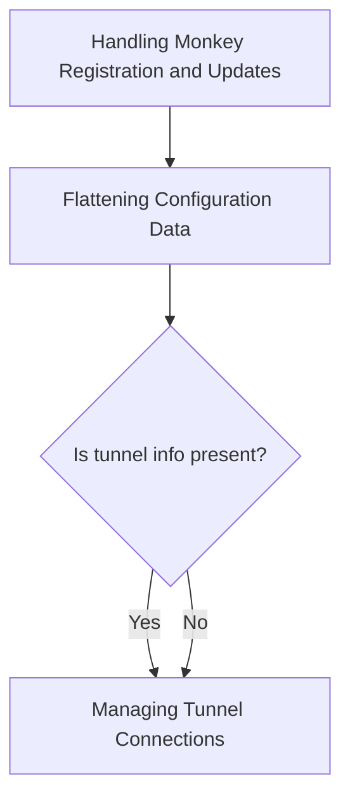
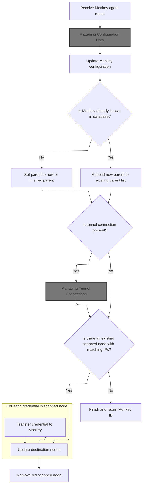
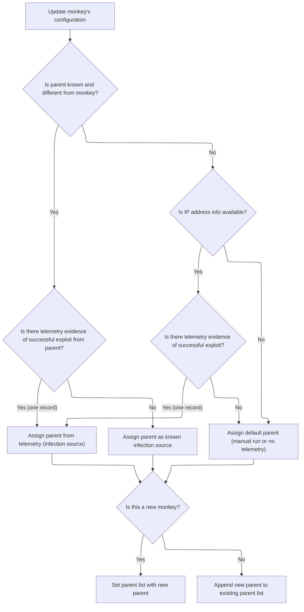
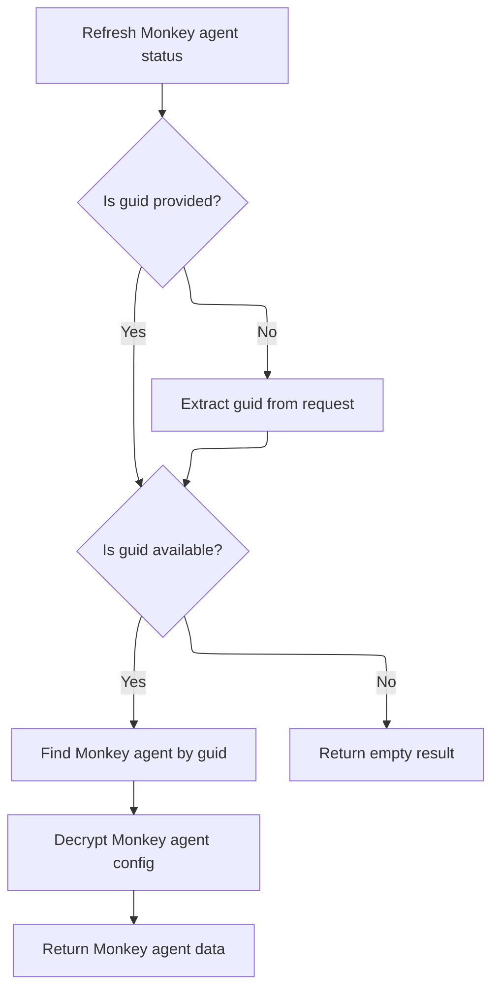
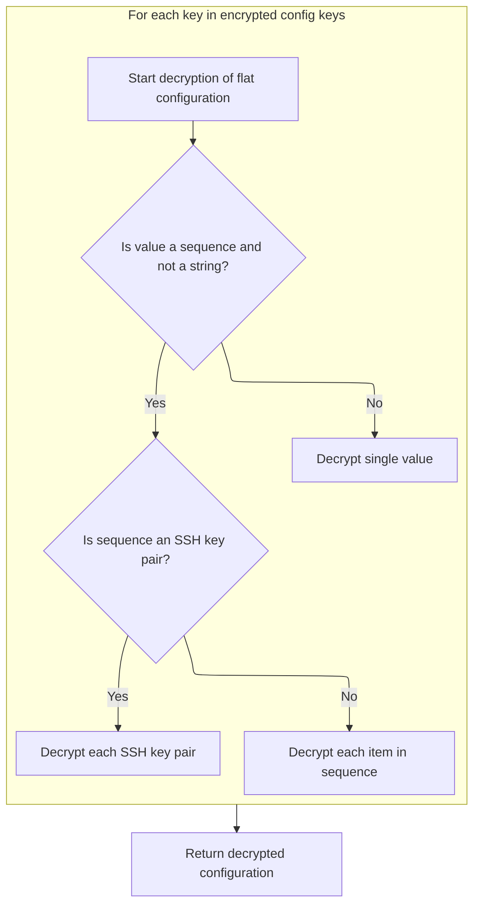
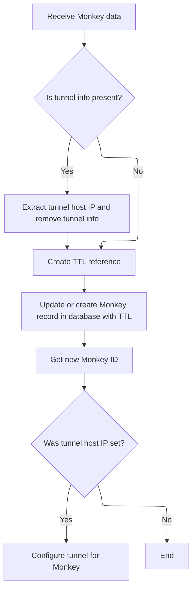
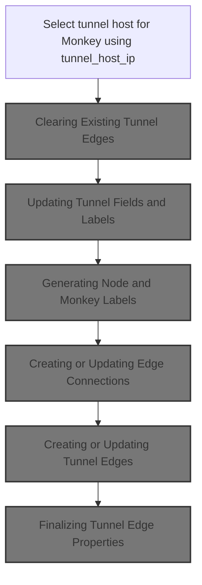
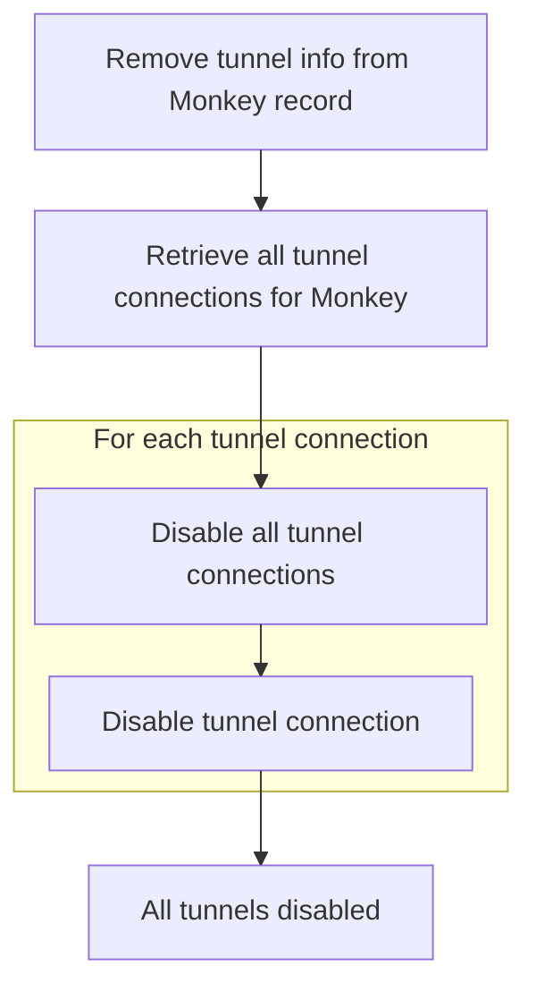
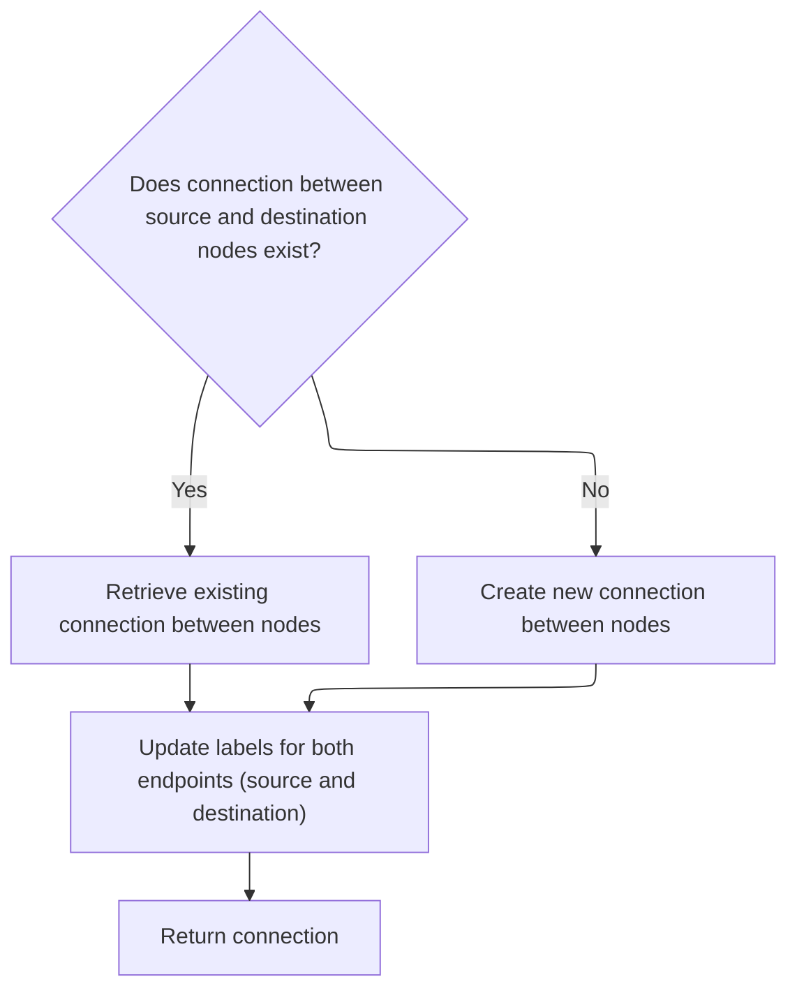
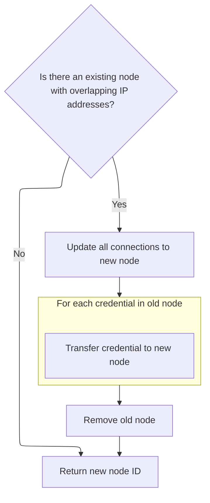

This document describes how Monkey agents are registered or updated in the system. The flow processes agent reports by merging configuration data, updating parent relationships based on infection paths, managing tunnel connections, and merging nodes with overlapping IP addresses to maintain an accurate network graph. The result is a consistently updated agent record and a returned unique identifier.



# Handling Monkey Registration and Updates



This section governs how Monkey agents are registered and updated in the system, ensuring that their configuration, parent relationships, and tunnel connections are accurately maintained in the database. It also manages the transfer of credentials and cleanup of scanned nodes when necessary.

| Category        | Rule Name                              | Description                                                                                                                                            |
| --------------- | -------------------------------------- | ------------------------------------------------------------------------------------------------------------------------------------------------------ |
| Data validation | Return Monkey ID on completion         | After all updates, the system must return the Monkey's unique identifier to confirm successful registration or update.                                 |
| Business logic  | Set parent for new Monkey              | If the Monkey agent is new (not found in the database), its parent must be set to a new or inferred parent based on the incoming data.                 |
| Business logic  | Update parent list for existing Monkey | If the Monkey agent already exists, any new parent information must be appended to the existing parent list, maintaining a history of infection paths. |

<SwmSnippet path="/monkey/monkey_island/cc/resources/monkey.py" line="65">

---

In `post`, we kick off by parsing the incoming JSON, setting up some default fields, and normalizing timestamps. We also make sure the initial config is saved if needed. Right after, we check if this monkey already exists in the DB and prep to update its config. We need to call into [config.py](http://config.py) next to pull the latest flat config, which gets merged into the monkey's config before we continue with parent/relationship logic.

```python
    def post(self, **kw):
        monkey_json = json.loads(request.data)
        monkey_json['creds'] = []
        monkey_json['dead'] = False
        if 'keepalive' in monkey_json:
            monkey_json['keepalive'] = dateutil.parser.parse(monkey_json['keepalive'])
        else:
            monkey_json['keepalive'] = datetime.now()

        monkey_json['modifytime'] = datetime.now()

        ConfigService.save_initial_config_if_needed()

        # if new monkey telem, change config according to "new monkeys" config.
        db_monkey = mongo.db.monkey.find_one({"guid": monkey_json["guid"]})

        # Update monkey configuration
        new_config = ConfigService.get_flat_config(False, False)
```

---

</SwmSnippet>

## Flattening Configuration Data

This section is responsible for transforming nested configuration data into a flat key-value structure, making it easier to merge and work with configuration values in the Infection Monkey system.

<SwmSnippet path="/monkey/monkey_island/cc/services/config.py" line="85">

---

In `get_flat_config`, we grab the nested config and prep to flatten it. This is needed so we can merge a simple key-value config into the monkey's data, which is easier to work with than a deeply nested structure.

```python
    def get_flat_config(is_initial_config=False, should_decrypt=True):
        config_json = ConfigService.get_config(is_initial_config, should_decrypt)
```

---

</SwmSnippet>

### Fetching Raw Configuration

This section is responsible for retrieving the raw configuration data required for Infection Monkey and Monkey Island to operate according to user or system settings. The configuration governs how the tool behaves, what features are enabled, and how the infection simulation is conducted.

See <SwmLink doc-title="Preparing and Returning Configuration Data">[Preparing and Returning Configuration Data](/.swm/preparing-and-returning-configuration-data.v3gkidxq.sw.md)</SwmLink>

### Flattening Nested Config Structure

<SwmSnippet path="/monkey/monkey_island/cc/services/config.py" line="87">

---

Just back from `get_config`, here we flatten the three-level nested config into a flat dict. This makes it easier to merge config values into the monkey's config field later.

```python
        flat_config_json = {}
        for i in config_json:
            for j in config_json[i]:
                for k in config_json[i][j]:
                    flat_config_json[k] = config_json[i][j][k]
```

---

</SwmSnippet>

<SwmSnippet path="/monkey/monkey_island/cc/services/config.py" line="91">

---

After flattening, we return a single-level dict with all config keys and values, ready to be merged into the monkey's config.

```python
                    flat_config_json[k] = config_json[i][j][k]

        return flat_config_json
```

---

</SwmSnippet>

## Updating Parent Relationships and Telemetry



<SwmSnippet path="/monkey/monkey_island/cc/resources/monkey.py" line="83">

---

Just back from [config.py](http://config.py), here we merge the new config into the monkey's config and then figure out the parent relationship. We use telemetry data to see if there's a successful exploit that links this monkey to a parent, and update the parent field accordingly. Next, we need to call get to fetch or update the monkey's DB record with the new parent info.

```python
        monkey_json['config'] = monkey_json.get('config', {})
        monkey_json['config'].update(new_config)

        # try to find new monkey parent
        parent = monkey_json.get('parent')
        parent_to_add = (monkey_json.get('guid'), None)  # default values in case of manual run
        if parent and parent != monkey_json.get('guid'):  # current parent is known
            exploit_telem = [x for x in
                             mongo.db.telemetry.find({'telem_category': {'$eq': 'exploit'},
                                                      'data.result': {'$eq': True},
                                                      'data.machine.ip_addr': {'$in': monkey_json['ip_addresses']},
                                                      'monkey_guid': {'$eq': parent}})]
            if 1 == len(exploit_telem):
                parent_to_add = (exploit_telem[0].get('monkey_guid'), exploit_telem[0].get('data').get('exploiter'))
            else:
                parent_to_add = (parent, None)
        elif (not parent or parent == monkey_json.get('guid')) and 'ip_addresses' in monkey_json:
            exploit_telem = [x for x in
                             mongo.db.telemetry.find({'telem_category': {'$eq': 'exploit'},
                                                      'data.result': {'$eq': True},
                                                      'data.machine.ip_addr': {'$in': monkey_json['ip_addresses']}})]

            if 1 == len(exploit_telem):
                parent_to_add = (exploit_telem[0].get('monkey_guid'), exploit_telem[0].get('data').get('exploiter'))

        if not db_monkey:
            monkey_json['parent'] = [parent_to_add]
        else:
            monkey_json['parent'] = db_monkey.get('parent') + [parent_to_add]

```

---

</SwmSnippet>

## Refreshing and Fetching Monkey Data



This section ensures that the Monkey Island server always provides up-to-date status and configuration data for Monkey agents, allowing users to reliably query the state of any agent by guid.

| Category        | Rule Name                | Description                                                                                           |
| --------------- | ------------------------ | ----------------------------------------------------------------------------------------------------- |
| Data validation | Guid extraction fallback | If a guid is not directly provided, the system must attempt to extract it from the request arguments. |

<SwmSnippet path="/monkey/monkey_island/cc/resources/monkey.py" line="26">

---

In `get`, we start by refreshing the dead/alive status of all monkeys. We call into [node.py](http://node.py) to update any monkeys that have timed out, so the data we fetch next is up to date.

```python
    def get(self, guid=None, **kw):
        NodeService.update_dead_monkeys()  # refresh monkeys status
```

---

</SwmSnippet>

<SwmSnippet path="/monkey/monkey_island/cc/services/node.py" line="363">

---

We check for recent keepalives and mark monkeys as dead if they're overdue.

```python
    def update_dead_monkeys():
        # Update dead monkeys only if no living monkey transmitted keepalive in the last 10 minutes
        if mongo.db.monkey.find_one(
                {'dead': {'$ne': True}, 'keepalive': {'$gte': datetime.now() - timedelta(minutes=10)}}):
            return

        # config.alive is changed to true to cancel the force kill of dead monkeys
        mongo.db.monkey.update(
            {'keepalive': {'$lte': datetime.now() - timedelta(minutes=10)}, 'dead': {'$ne': True}},
            {'$set': {'dead': True, 'config.alive': True, 'modifytime': datetime.now()}}, upsert=False, multi=True)
```

---

</SwmSnippet>

<SwmSnippet path="/monkey/monkey_island/cc/resources/monkey.py" line="28">

---

Just back from [node.py](http://node.py), in `get` we check for a guid (from args if not passed directly), fetch the monkey doc, and decrypt its config before returning. If no guid, we just return an empty dict. Next, we call [config.py](http://config.py) to handle the decryption.

```python
        if not guid:
            guid = request.args.get('guid')

        if guid:
            monkey_json = mongo.db.monkey.find_one_or_404({"guid": guid})
            monkey_json['config'] = ConfigService.decrypt_flat_config(monkey_json['config'])
            return monkey_json

        return {}
```

---

</SwmSnippet>

## Decrypting Flat Configuration



This section is responsible for decrypting all encrypted values in a flat configuration dictionary, ensuring that both SSH key pairs and other encrypted values are properly handled and returned in a usable format for the client.

| Category        | Rule Name                 | Description                                                                                                                                                                                |
| --------------- | ------------------------- | ------------------------------------------------------------------------------------------------------------------------------------------------------------------------------------------ |
| Data validation | Encrypted keys whitelist  | Only configuration keys listed in ENCRYPTED_CONFIG_ARRAYS are considered for decryption.                                                                                                   |
| Business logic  | Sequence value decryption | If a configuration value is a sequence (but not a string), each item in the sequence must be decrypted individually.                                                                       |
| Business logic  | SSH key pair handling     | If a sequence represents SSH key pairs (identified by the presence of a 'public_key' in the first item), each key pair must be decrypted using a dedicated SSH key pair decryption method. |
| Business logic  | Single value decryption   | If a configuration value is not a sequence, it must be decrypted as a single value using the general decryptor.                                                                            |
| Business logic  | Return decrypted config   | The decrypted configuration must be returned as a complete dictionary, preserving the original structure but with all targeted values decrypted.                                           |

<SwmSnippet path="/monkey/monkey_island/cc/services/config.py" line="279">

---

In `decrypt_flat_config`, we figure out which keys need decryption using ENCRYPTED_CONFIG_ARRAYS. We handle SSH key pairs separately, and prep to decrypt each value as needed. Next, we call into [encryptor.py](http://encryptor.py) for the actual decryption.

```python
    def decrypt_flat_config(flat_config, is_island=False):
        """
        Same as decrypt_config but for a flat configuration
        """
        keys = [config_arr_as_array[2] for config_arr_as_array in ENCRYPTED_CONFIG_ARRAYS]

        for key in keys:
            if isinstance(flat_config[key], collections.Sequence) and not isinstance(flat_config[key], str):
                # Check if we are decrypting ssh key pair
                if flat_config[key] and isinstance(flat_config[key][0], dict) and 'public_key' in flat_config[key][0]:
                    flat_config[key] = [ConfigService.decrypt_ssh_key_pair(item) for item in flat_config[key]]
                else:
```

---

</SwmSnippet>

<SwmSnippet path="/monkey/monkey_island/cc/services/config.py" line="291">

---

Just back from [config.py](http://config.py), here we actually decrypt each config value. SSH key pairs get their own decryption, everything else goes through encryptor.dec. This gives us a usable config dict for the client.

```python
                    flat_config[key] = [encryptor.dec(item) for item in flat_config[key]]
            else:
                flat_config[key] = encryptor.dec(flat_config[key])
        return flat_config
```

---

</SwmSnippet>

## Setting Up TTL and Tunnel Relationships



<SwmSnippet path="/monkey/monkey_island/cc/resources/monkey.py" line="113">

---

Just back from get, here we create a TTL doc for the monkey and link it via 'ttl_ref'. We then update or insert the monkey in the DB, and if there's a tunnel, we prep to set up the tunnel relationship by calling [node.py](http://node.py) next.

```python
        tunnel_host_ip = None
        if 'tunnel' in monkey_json:
            tunnel_host_ip = monkey_json['tunnel'].split(":")[-2].replace("//", "")
            monkey_json.pop('tunnel')

        ttl = create_monkey_ttl_document(DEFAULT_MONKEY_TTL_EXPIRY_DURATION_IN_SECONDS)
        monkey_json['ttl_ref'] = ttl.id

        mongo.db.monkey.update({"guid": monkey_json["guid"]},
                               {"$set": monkey_json},
                               upsert=True)

        # Merge existing scanned node with new monkey

        new_monkey_id = mongo.db.monkey.find_one({"guid": monkey_json["guid"]})["_id"]

        if tunnel_host_ip is not None:
            NodeService.set_monkey_tunnel(new_monkey_id, tunnel_host_ip)

```

---

</SwmSnippet>

## Managing Tunnel Connections



This section governs how tunnel connections are managed for Monkey agents, ensuring that each Monkey can have only one active tunnel at a time, and that all tunnel-related metadata and relationships are kept accurate and up-to-date.

| Category       | Rule Name                         | Description                                                                                                                                               |
| -------------- | --------------------------------- | --------------------------------------------------------------------------------------------------------------------------------------------------------- |
| Business logic | Update tunnel metadata and labels | When a new tunnel is established, all relevant labels and metadata for both the Monkey and the tunnel host must be updated to reflect the new connection. |

<SwmSnippet path="/monkey/monkey_island/cc/services/node.py" line="195">

---

In `set_monkey_tunnel`, we look up the tunnel host by IP, assuming it's valid. Next, we call unset_all_monkey_tunnels to clear any existing tunnels for this monkey before setting the new one.

```python
    def set_monkey_tunnel(monkey_id, tunnel_host_ip):
        tunnel_host_id = NodeService.get_monkey_by_ip(tunnel_host_ip)["_id"]
```

---

</SwmSnippet>

<SwmSnippet path="/monkey/monkey_island/cc/services/node.py" line="291">

---

`get_monkey_by_ip` just queries the DB for a monkey with the given IP in its ip_addresses list. Assumes IPs are unique per monkey.

```python
    def get_monkey_by_ip(ip_address):
        return mongo.db.monkey.find_one({"ip_addresses": ip_address})
```

---

</SwmSnippet>

<SwmSnippet path="/monkey/monkey_island/cc/services/node.py" line="197">

---

Just back from get_monkey_by_ip, now we clear all existing tunnels for this monkey by calling unset_all_monkey_tunnels. This keeps the tunnel relationship one-to-one.

```python
        NodeService.unset_all_monkey_tunnels(monkey_id)
```

---

</SwmSnippet>

### Clearing Existing Tunnel Edges



This section governs the process for clearing all existing tunnel connections associated with a Monkey instance in Infection Monkey. It ensures that tunnel information is removed from the Monkey record and that all relevant tunnel connections are disabled, maintaining network integrity and accurate system state.

<SwmSnippet path="/monkey/monkey_island/cc/services/node.py" line="184">

---

In `unset_all_monkey_tunnels`, we unset the tunnel field in the monkey doc and then fetch all tunnel edges for this monkey. Next, we call [edge.py](http://edge.py) to get those edges so we can disable them.

```python
    def unset_all_monkey_tunnels(monkey_id):
        mongo.db.monkey.update(
            {"_id": monkey_id},
            {'$unset': {'tunnel': ''}},
            upsert=False)

        edges = EdgeService.get_tunnel_edges_by_src(monkey_id)
```

---

</SwmSnippet>

<SwmSnippet path="/monkey/monkey_island/cc/services/edge/edge.py" line="57">

---

`get_tunnel_edges_by_src` fetches all edges for this monkey where tunnel=True. Only these edges are relevant for tunnel cleanup.

```python
    def get_tunnel_edges_by_src(src_node_id) -> List[EdgeService]:
        try:
            return EdgeService.objects(src_node_id=src_node_id, tunnel=True)
        except DoesNotExist:
            return []
```

---

</SwmSnippet>

<SwmSnippet path="/monkey/monkey_island/cc/services/node.py" line="191">

---

Just back from [edge.py](http://edge.py), now we loop through the tunnel edges and call disable_tunnel on each. This marks them as inactive in the graph.

```python
        for edge in edges:
            edge.disable_tunnel()
```

---

</SwmSnippet>

<SwmSnippet path="/monkey/monkey_island/cc/services/node.py" line="192">

---

Unset_all_monkey_tunnels doesn't return anything, it just clears tunnels and disables edges.

```python
            edge.disable_tunnel()
```

---

</SwmSnippet>

### Updating Tunnel Fields and Labels

<SwmSnippet path="/monkey/monkey_island/cc/services/node.py" line="198">

---

Just back from clearing tunnels, now we set the new tunnel field in the monkey doc and fetch labels for both the monkey and the tunnel host. Next, we call get_label_for_endpoint to get those labels.

```python
        mongo.db.monkey.update(
            {'_id': monkey_id},
            {'$set': {'tunnel': tunnel_host_id}},
            upsert=False)
        monkey_label = NodeService.get_label_for_endpoint(monkey_id)
        tunnel_host_label = NodeService.get_label_for_endpoint(tunnel_host_id)
```

---

</SwmSnippet>

### Generating Node and Monkey Labels

```mermaid
%%{init: {"flowchart": {"defaultRenderer": "elk"}} }%%
flowchart TD
    node1["Given an endpoint ID"] --> node2{"Is endpoint the MonkeyIsland server?"}
    click node1 openCode "monkey/monkey_island/cc/services/node.py:424:425"
    click node2 openCode "monkey/monkey_island/cc/services/node.py:425:426"
    node2 -->|"Yes"| node3["Label as 'MonkeyIsland' (Control Server)"]
    click node3 openCode "monkey/monkey_island/cc/services/node.py:426:426"
    node2 -->|"No"| node4{"Is endpoint a Monkey agent?"}
    click node4 openCode "monkey/monkey_island/cc/services/node.py:427:428"
    node4 -->|"Yes"| node5["Label as Monkey (hostname : IP) (Agent)"]
    click node5 openCode "monkey/monkey_island/cc/models/monkey.py:104:109"
    node4 -->|"No"| node6[Label as Node (OS version : IP [domain name])] 
    click node6 openCode "monkey/monkey_island/cc/services/node.py:430:430"
classDef HeadingStyle fill:#777777,stroke:#333,stroke-width:2px;
```

This section governs the rules for generating descriptive labels for endpoints in the Infection Monkey system, ensuring that each endpoint is clearly identified as either the control server, a Monkey agent, or a regular node, with relevant details included in the label.

| Category        | Rule Name                          | Description                                                                                                                                                                               |
| --------------- | ---------------------------------- | ----------------------------------------------------------------------------------------------------------------------------------------------------------------------------------------- |
| Data validation | Label completeness validation      | If the node or Monkey agent data is missing required fields (such as IP address, hostname, or OS version), the label generation must fail gracefully and not produce an incomplete label. |
| Business logic  | MonkeyIsland server identification | If the endpoint ID matches the reserved MonkeyIsland server ID ('000000000000000000000000'), the label must be set to 'MonkeyIsland'.                                                     |
| Business logic  | Monkey agent labeling              | If the endpoint is identified as a Monkey agent, its label must include the hostname and first IP address, and be prefixed with 'MonkeyIsland - ' if the IP matches the local network.    |
| Business logic  | Node labeling                      | If the endpoint is a regular node, its label must include the OS version, first IP address, and domain name (if present).                                                                 |

<SwmSnippet path="/monkey/monkey_island/cc/services/node.py" line="424">

---

In `get_label_for_endpoint`, we check if the endpoint is the special MonkeyIsland ID, a monkey, or a regular node. If it's a monkey, we call into [monkey.py](http://monkey.py) to get its label next.

```python
    def get_label_for_endpoint(endpoint_id):
        if endpoint_id == ObjectId("000000000000000000000000"):
            return 'MonkeyIsland'
        if Monkey.is_monkey(endpoint_id):
            return Monkey.get_label_by_id(endpoint_id)
        else:
```

---

</SwmSnippet>

<SwmSnippet path="/monkey/monkey_island/cc/models/monkey.py" line="104">

---

`get_label_by_id` builds a label from the monkey's hostname and first IP, and adds 'MonkeyIsland - ' if the IP matches the local network. This helps spot local monkeys at a glance.

```python
    def get_label_by_id(object_id):
        current_monkey = Monkey.get_single_monkey_by_id(object_id)
        label = Monkey.get_hostname_by_id(object_id) + " : " + current_monkey.ip_addresses[0]
        if len(set(current_monkey.ip_addresses).intersection(local_ip_addresses())) > 0:
            label = "MonkeyIsland - " + label
        return label
```

---

</SwmSnippet>

<SwmSnippet path="/monkey/monkey_island/cc/services/node.py" line="430">

---

Just back from [monkey.py](http://monkey.py), if the endpoint isn't a monkey, we fetch the node by ID and build its label using [node.py](http://node.py). This keeps the labeling logic consistent.

```python
            return NodeService.get_node_label(NodeService.get_node_by_id(endpoint_id))
```

---

</SwmSnippet>

<SwmSnippet path="/monkey/monkey_island/cc/services/node.py" line="299">

---

`get_node_by_id` just fetches a node from the DB by its ObjectId. Assumes the ID is valid and the node exists.

```python
    def get_node_by_id(node_id):
        return mongo.db.node.find_one({"_id": ObjectId(node_id)})
```

---

</SwmSnippet>

<SwmSnippet path="/monkey/monkey_island/cc/services/node.py" line="430">

---

Just back from fetching the node, now we build its label using get_node_label. Assumes the node dict has all the right fields.

```python
            return NodeService.get_node_label(NodeService.get_node_by_id(endpoint_id))
```

---

</SwmSnippet>

<SwmSnippet path="/monkey/monkey_island/cc/services/node.py" line="80">

---

`get_node_label` builds a label from the node's OS version, first IP, and domain name if present. Assumes all these fields exist in the node dict.

```python
    def get_node_label(node):
        domain_name = ""
        if node["domain_name"]:
            domain_name = " (" + node["domain_name"] + ")"
        return node["os"]["version"] + " : " + node["ip_addresses"][0] + domain_name
```

---

</SwmSnippet>

### Creating or Updating Tunnel Edges

<SwmSnippet path="/monkey/monkey_island/cc/services/node.py" line="204">

---

Just back from [node.py](http://node.py), now we create or update the tunnel edge between the monkey and the tunnel host, using their labels. Next, we call [edge.py](http://edge.py) to handle the edge logic.

```python
        tunnel_edge = EdgeService.get_or_create_edge(src_node_id=monkey_id,
                                                     dst_node_id=tunnel_host_id,
                                                     src_label=monkey_label,
                                                     dst_label=tunnel_host_label)
```

---

</SwmSnippet>

### Creating or Updating Edge Connections



This section governs how connections (edges) between nodes are created or updated in the Infection Monkey network graph, ensuring that each edge always has the most current label information for both endpoints. This is critical for accurate graph queries and UI representation.

| Category        | Rule Name                 | Description                                                                                                                                |
| --------------- | ------------------------- | ------------------------------------------------------------------------------------------------------------------------------------------ |
| Data validation | Endpoint validation       | If the node ID provided for label update does not match either endpoint of the edge, raise an error and do not update the label.           |
| Business logic  | Reuse existing connection | If a connection (edge) between the source and destination nodes already exists, retrieve the existing edge rather than creating a new one. |
| Business logic  | Create new connection     | If no connection exists between the source and destination nodes, create a new edge to represent the relationship.                         |
| Business logic  | Update endpoint labels    | Whenever an edge is created or retrieved, update the labels for both endpoints to reflect the latest information provided.                 |

<SwmSnippet path="/monkey/monkey_island/cc/services/edge/edge.py" line="21">

---

`get_or_create_edge` either fetches an existing edge between two nodes or creates a new one if it doesn't exist. Right after, it updates the labels for both endpoints using `update_label`, so the edge always has up-to-date info for both sides. We need to call this because the tunnel relationship between two monkeys (or a monkey and a node) is represented as an edge, and keeping the labels fresh is key for graph queries and UI.

```python
    def get_or_create_edge(src_node_id, dst_node_id, src_label, dst_label) -> EdgeService:
        edge = None
        try:
            edge = EdgeService.objects.get(src_node_id=src_node_id, dst_node_id=dst_node_id)
        except DoesNotExist:
            edge = EdgeService(src_node_id=src_node_id, dst_node_id=dst_node_id)
        finally:
            if edge:
                edge.update_label(node_id=src_node_id, label=src_label)
                edge.update_label(node_id=dst_node_id, label=dst_label)
        return edge
```

---

</SwmSnippet>

<SwmSnippet path="/monkey/monkey_island/cc/services/edge/edge.py" line="41">

---

`update_label` sets the label for the correct endpoint of the edge and errors out if the node_id doesn't match either side.

```python
    def update_label(self, node_id: ObjectId, label: str):
        if self.src_node_id == node_id:
            self.src_label = label
        elif self.dst_node_id == node_id:
            self.dst_label = label
        else:
            raise DoesNotExist("Node id provided does not match with any endpoint of an self provided.")
        self.save()
```

---

</SwmSnippet>

### Finalizing Tunnel Edge Properties

<SwmSnippet path="/monkey/monkey_island/cc/services/node.py" line="208">

---

After updating labels, we mark the edge as a tunnel and set its IP, then save it so the graph reflects the new tunnel connection.

```python
        tunnel_edge.tunnel = True
        tunnel_edge.ip_address = tunnel_host_ip
        tunnel_edge.save()
```

---

</SwmSnippet>

## Merging Existing Nodes with New Monkeys



<SwmSnippet path="/monkey/monkey_island/cc/resources/monkey.py" line="132">

---

Just back from [node.py](http://node.py), in `post` we check for any existing node with IPs matching the new monkey. If found, we update all edges to point to the new monkey, transfer credentials, and remove the old node. This keeps the graph clean and avoids duplicate nodes.

```python
        existing_node = mongo.db.node.find_one({"ip_addresses": {"$in": monkey_json["ip_addresses"]}})

        if existing_node:
            node_id = existing_node["_id"]
            EdgeService.update_all_dst_nodes(old_dst_node_id=node_id,
                                             new_dst_node_id=new_monkey_id)
            for creds in existing_node['creds']:
                NodeService.add_credentials_to_monkey(new_monkey_id, creds)
```

---

</SwmSnippet>

<SwmSnippet path="/monkey/monkey_island/cc/resources/monkey.py" line="139">

---

After all the merging and updates, `post` just returns the ObjectId of the monkey entity. This is what the client uses to reference the monkey going forward, regardless of whether it was a new insert or a merge.

```python
                NodeService.add_credentials_to_monkey(new_monkey_id, creds)
            mongo.db.node.remove({"_id": node_id})

        return {"id": new_monkey_id}
```

---

</SwmSnippet>

&nbsp;

*This is an auto-generated document by Swimm 🌊 and has not yet been verified by a human*

<SwmMeta version="3.0.0" repo-id="Z2l0aHViJTNBJTNBYmFja2VuZC1zd2ltbSUzQSUzQXJpY2FyZG9sb3Blemc=" repo-name="backend-swimm"><sup>Powered by [Swimm](https://app.swimm.io/)</sup></SwmMeta>
